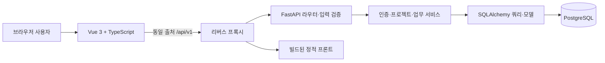
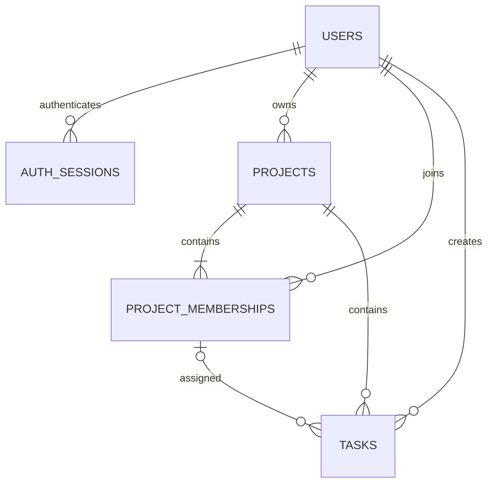

# AM_PM 재구현 — MVP 상세 설계

- 작성일: 2026-10-03 (Asia/Seoul)
- 문서 버전: 0.2 — 제약 검토 보완, 사용자 검토 전
- 상태: 사용자 검토용 설계안 — 구현 계획 작성 완료, 제품 구현 전
- 대상: Vue 3 + TypeScript / Python + FastAPI 프로젝트 관리 서비스

## 0. 문서 사용법

이 문서는 구현 결과가 아니라 앞으로 구현할 제품의 계약이다. 현재 작성된 것은 설계 문서뿐이다. 아래의 기본값은 사용자가 직접 선택한 사항과 구분했으며, 사용자가 문서를 검토하면서 바꿀 수 있다. 구현자는 미정 정책을 임의로 만드는 대신 이 문서의 기본값을 따른다.

세 문서는 하나의 설계를 구성한다.

| 문서 | 담당 내용 |
|---|---|
| 이 문서 | 범위, 의사결정, 아키텍처, 데이터, 인증, 권한, 트랜잭션, 실행 환경 |
| [API 계약서](2026-10-03-am-pm-mvp-api-contract.md) | 엔드포인트, 입력·출력, 버전 충돌, 페이지네이션, 오류 |
| [화면·검증 명세](2026-10-03-am-pm-mvp-screens-verification.md) | 화면별 동작, 상태, 접근성, 수용 기준, 테스트, 시연 |

시각 자료: [시스템 구조도·화면 흐름도](2026-10-03-am-pm-mvp-diagrams.md). 설계 본문의 구조와 규칙을 네 가지 그림으로 확인할 수 있다.

검토 자료: [제약사항 검토](2026-10-03-am-pm-mvp-constraints-review.md), [테스트 계획](../plans/2026-10-03-am-pm-mvp-test-plan.md). 0.2에서는 Swagger 출처, 본문 크기, Session 수명, 요청 제한의 정확한 의미, 보드 일관성 범위를 보완했다. 이 변경은 검토용 설계 수정이며 제품 구현·배포 승인이 아니다.

실행 준비 자료: [구현 계획](../plans/2026-10-04-am-pm-mvp-implementation-plan.md), [환경 설정 계획](../plans/2026-10-04-am-pm-mvp-environment-plan.md). 작업별 파일·인터페이스·검증·설치 순서를 정의했으며 아직 실행하지 않았다.

같은 정책을 요약해 반복한 경우 데이터·권한은 본문, HTTP 계약은 API 계약서, UI 동작은 화면 명세를 기준으로 한다. 상충 사항이 발견되면 구현 전에 세 문서를 함께 수정한다.

### 0.1 사용자가 확정한 사항

1. 기존 AM_PM 서비스를 Python + FastAPI로 재구현한다.
2. 목적은 학습·포트폴리오이며 구조 개선을 포함한다.
3. 프론트엔드도 새로 구현하며 Vue 3 + TypeScript를 사용한다.
4. 첫 버전은 로그인, 프로젝트, 팀원·역할, 업무·일정 관리까지 완성한다.
5. 설계 문서를 가능한 한 구체적으로 작성한다.

### 0.2 이번 문서에서 제안하는 기본값

| 항목 | 기본값 | 이유 |
|---|---|---|
| 주 사용자 | 소규모 학습·개발 팀 | 원본 서비스의 팀 프로젝트 관리 목적에 맞춤 |
| 데이터베이스 | PostgreSQL | FK·제약조건·트랜잭션을 명확하게 학습·검증 |
| 인증 | 이메일·비밀번호 + DB 세션 + HttpOnly 쿠키 | 브라우저 앱에서 로그아웃·세션 만료를 단순하게 구현 |
| 역할 | 프로젝트 소유자 1명, 일반 팀원 | 권한 정책의 범위를 제한 |
| 팀원 추가 | 이미 가입한 사용자의 정확한 이메일로 즉시 추가 | 초대 이메일·승인 대기 시스템을 첫 버전에서 제외 |
| 업무 권한 | 모든 팀원이 생성·수정, 소유자 또는 작성자가 삭제 | 협업 편의와 삭제 권한을 구분 |
| 일정 | 날짜 단위 시작일·마감일, 시간 예약 없음 | 업무 일정에 필요한 최소 단위 |
| 화면 | 한국어, 데스크톱 우선 반응형, 밝은 테마 | 시연에 집중하고 접근성 확보 |
| 기존 데이터 | 이관하지 않고 새 DB에서 시작 | 학습용 재구현의 범위에 집중 |
| 배포 | 동일 출처 웹·API, 단일 API 인스턴스 | 초기 운영·인증·오류 추적을 단순화 |
| 소스 배치 | 기존 저장소의 `frontend/`, `backend/`에 새 코드 | 기존 `Client/`, `Server/`와 비교 가능 |

DB, 인증, 화면 세부 디자인, 배포 기본값은 사용자의 개별 선택을 받은 것으로 간주하지 않는다. 본 문서에 대한 검토 대상이다. 공개 실사용 서비스의 계정 복구·이메일 소유 확인까지 제공하는 범위는 아니다.

## 1. 제품 목표와 완료 조건

### 1.1 핵심 사용자 여정

사용자 A가 가입하고 로그인한다. 프로젝트를 생성하고 가입된 사용자 B를 팀원으로 추가한다. A 또는 B가 업무를 만들고 담당자와 마감일을 정한다. 두 사람은 같은 프로젝트에서 업무를 수정하고 상태를 바꾼다. 프로젝트에 속하지 않은 사용자 C는 해당 프로젝트의 내용에 접근할 수 없다.

성공의 기준은 화면이 보이는 데 그치지 않는다. 새로고침·재로그인 후에도 데이터가 유지되고, API를 직접 호출해도 권한과 데이터 규칙이 지켜져야 한다.

### 1.2 기능 요구사항

| ID | 기능 | 완료 기준 |
|---|---|---|
| FR-01 | 계정 생성 | 이메일 중복 거부, 비밀번호 해시 저장, 가입 후 로그인 화면 이동 |
| FR-02 | 로그인·로그아웃 | 인증 성공 시 세션 발급, 만료·로그아웃 시 접근 차단 |
| FR-03 | 내 프로젝트 목록 | 내가 소속된 프로젝트만 검색·페이지 조회 |
| FR-04 | 프로젝트 관리 | 생성·조회·수정·삭제, 소유자 권한 적용 |
| FR-05 | 팀원 관리 | 등록 사용자 추가, 중복 방지, 팀원 제거·탈퇴 |
| FR-06 | 소유권 이전 | 기존 팀원에게 원자적으로 이전, 소유자 1명 유지 |
| FR-07 | 업무 관리 | 생성·상세·수정·삭제, 담당자·기간·상태 관리 |
| FR-08 | 업무 탐색 | 상태·담당자·마감 범위·지연 여부 필터, 제목 검색 |
| FR-09 | 업무 표현 | 페이지 목록과 상태별 보드, 두 화면에서 동일한 데이터 사용 |
| FR-10 | 오류·동시 수정 | 필드 오류, 권한 오류, 수정 충돌, 네트워크 실패 안내 |

### 1.3 첫 버전에 포함하지 않는 기능

Google 로그인, 비밀번호 찾기, 이메일 인증·초대 메일, 회원 탈퇴, 프로필 편집·이미지, 기획 문서, 실시간 채팅, 공지·Q&A, 첨부 파일, 간트 차트, 일정 캘린더, 업무 의존성, 댓글, 알림, 조직·관리자 시스템, Redis·작업 큐, 실시간 동기화, 기존 DB 마이그레이션은 후속 범위다.

보드의 드래그 정렬·드래그 상태 변경도 제외한다. 상태 변경은 드롭다운으로 구현한다. 목록·보드·폼만으로 첫 사용자 여정이 완결되어야 한다.

## 2. 원본 분석과 변경 근거

분석 기준: 원본 저장소 `huiji-park/AM_PM`, 커밋 `c47bf17df2c045635c96fe6ac6032b969b0aafdb`. 정적 코드 분석이며 원본의 실행 가능성이나 전체 보안 감사를 확인한 것은 아니다.

| 원본에서 확인한 사실 | 근거 파일 | 새 설계 |
|---|---|---|
| Vue 3 JavaScript 프론트와 Spring Boot 3.2 서버 | `Client/package.json`, `Server/build.gradle` | Vue TypeScript / FastAPI 신규 구성 |
| 팀원 역할이 `member`, `representative_member` | `Server/src/main/java/phoenix/AM_PM/domain/members/entity/Roles.java` | 소유자 ID 한 곳에서 역할을 파생 |
| 업무의 프로젝트는 정수, 담당자 표현은 닉네임 문자열 | `Server/src/main/java/phoenix/AM_PM/domain/task/entity/Task.java` | 프로젝트·담당자 FK와 상태·버전 도입 |
| 업무 컨트롤러에서 저장소 직접 호출 | `Server/src/main/java/phoenix/AM_PM/domain/task/controller/TaskController.java` | API 처리와 업무 규칙 분리 |
| 팀원 추가 예외를 잡은 뒤에도 201을 반환할 수 있음 | `Server/src/main/java/phoenix/AM_PM/domain/members/controller/MembersController.java` | 성공 커밋 이후 응답, 오류 공통 매핑 |
| 프로젝트 생성 시 프로젝트와 소유 멤버를 별도로 저장 | `Server/src/main/java/phoenix/AM_PM/domain/project/service/ProjectService.java` | 두 레코드를 단일 트랜잭션에서 생성 |
| 팀원이 여러 명이면 프로젝트 삭제 거부 | 위 `ProjectService.java` | 소유자 확인 후 프로젝트와 하위 업무·멤버 삭제 |
| 원본 라우터에 일부 경로가 중복 선언됨 | `Client/src/router/index.js` | 프로젝트 ID 중심의 명시적 중첩 라우팅 |

위 변경은 Java 코드를 한 줄씩 번역하는 작업이 아니라 도메인 규칙을 다시 표현하는 것이다. 특히 원본 삭제 정책과 새 삭제 정책의 차이는 의도적인 제품 변경이다.

## 3. 아키텍처 결정

### 3.1 대안 비교

| 대안 | 장점 | 비용 | 선택 |
|---|---|---|---|
| CRUD 라우터에 조회·규칙 집중 | 시작이 빠름 | 권한·트랜잭션 중복과 테스트 결합 | 제외 |
| 기능별 모듈을 가진 단일 서버 | 규칙·테스트 경계가 명확하고 운영이 단순 | 모듈 책임 정의 필요 | 채택 |
| 기능별 독립 서비스 | 독립 배포 가능 | 통신·인증·분산 트랜잭션 부담 | 현 범위에서 제외 |

하나의 저장소, 하나의 FastAPI 앱, 하나의 DB를 사용한다. 기능별 API는 `APIRouter`로 분리한다. 이는 FastAPI가 제공하는 앱 분할 방식이다. [FastAPI 공식 문서](https://fastapi.tiangolo.com/tutorial/bigger-applications/)



### 3.2 기술 구성

| 계층 | 선택 | 사용 범위 |
|---|---|---|
| 런타임 | Python 3.13 계열 | 프로젝트 기준 버전; 설치 환경은 구현 착수 시 검증 |
| API | FastAPI + Pydantic 2 | 입력·출력 검증, 의존성, OpenAPI |
| 데이터 | SQLAlchemy 2 + psycopg 3, 동기 방식 | 요청별 Session, 명시적 트랜잭션 |
| 마이그레이션 | Alembic | 테이블·FK·인덱스 변경 이력 |
| DB | PostgreSQL 18 계열 | 개발·통합 테스트·시연 환경 통일 |
| 비밀번호 | pwdlib의 Argon2 지원 | 해시 생성·검증, 라이브러리 권장 설정 사용 |
| 프론트 | Vue 3, TypeScript strict, Vite | SPA와 정적 빌드 |
| 상태·라우팅 | Pinia, Vue Router | 인증·페이지별 상태, 라우트 가드 |
| HTTP | 브라우저 fetch 공통 래퍼 | 쿠키, 요청 ID, 공통 오류 매핑 |
| UI | CSS 변수 + 공통 Vue 컴포넌트 | 외부 UI 프레임워크 없이 일관된 폼·대화상자 |
| 검증 | pytest, Vue Test Utils + Vitest, Playwright | 규칙·API·컴포넌트·사용자 흐름 |
| 실행 | Docker Compose, Nginx | DB와 재현 가능한 시연 환경 |

이는 목표 기술 조합이지 현재 설치된 패키지 목록이 아니다. 최신 버전이라는 주장을 하지 않는다. 정확한 패치 버전과 Node LTS는 구현 시 호환성을 확인하여 lockfile에 고정한다. 버전 갱신이 이 문서의 동작 계약을 바꾸지는 않는다.

동기 DB 작업은 동기 `def` 경로·의존성에서 처리한다. `async def` 내부에서 동기 DB I/O를 직접 실행하지 않는다. MVP에서 비동기 DB와 동기 DB 방식을 혼용하지 않는다.

### 3.3 모듈 경계

| 모듈 | 책임 | 다른 모듈과의 계약 |
|---|---|---|
| `auth` | 가입, 비밀번호, 세션, 현재 사용자 | 인증된 사용자 ID 제공 |
| `users` | 계정 모델, 정확한 이메일 조회 | 비밀번호 없는 사용자 요약 반환 |
| `projects` | 프로젝트 CRUD, 소유권, 소속 정책 | 접근 가능한 프로젝트·팀원 조회 |
| `memberships` | 팀원 추가·제거·탈퇴 | 프로젝트 소유권 규칙 재사용 |
| `tasks` | 업무 CRUD, 상태, 담당자, 필터 | 프로젝트 소속 검증 후 업무 처리 |
| `core` | 설정, 오류, 로그, 공통 HTTP 정책 | 도메인 규칙을 포함하지 않음 |
| `db` | 엔진, Session, 모델 공통 타입 | 앱 요청과 CLI의 연결 수명 관리 |

라우터는 입력 변환·의존성·HTTP 응답만 담당한다. 서비스는 권한·업무 규칙·트랜잭션의 소유자다. 쿼리 함수는 SQL 구성과 조회를 담당하며 스스로 커밋하지 않는다. ORM 객체는 외부로 직접 직렬화하지 않고 응답 스키마로 변환한다. 범용 BaseRepository나 범용 CRUD 서비스는 만들지 않는다.

`projects`가 소속 정책의 기준이다. 프로젝트 삭제 등 여러 테이블을 바꾸는 동작은 하나의 서비스가 조정하며, 다른 HTTP 엔드포인트를 내부에서 호출하지 않는다.

### 3.4 계획된 디렉터리

```text
AM_PM/
  Client/                     # 원본 Vue 참고 코드
  Server/                     # 원본 Spring 참고 코드
  backend/
    app/
      main.py
      core/                   # config, errors, logging, origin 검사
      db/                     # engine, session, base
      auth/                   # router, schemas, service, sessions
      users/                  # model, queries, schemas
      projects/               # router, schemas, service, queries, model, policies
      memberships/            # router, schemas, service, queries, model
      tasks/                  # router, schemas, service, queries, model
      health/
    migrations/
    tests/                    # unit, integration
    pyproject.toml
    uv.lock
  frontend/
    src/
      app/                    # router, 초기화, 전체 레이아웃
      features/               # auth, projects, members, tasks
      shared/                 # api, ui, styles, 공통 타입
    tests/                    # component, e2e
    package.json
    package-lock.json
  infra/                      # 이미지 빌드·프록시 설정
  compose.yaml
  docs/superpowers/specs/
```

이 구조는 작성할 코드의 배치 계약이다. 현 단계에서 위 제품 디렉터리·의존성은 생성하지 않는다. 신규 프로젝트의 루트 README는 후속 구현 때 원본 소개와 재구현 안내를 구분해 정리한다.

## 4. 도메인·권한 규칙

### 4.1 용어

사용자는 계정을 가진 사람이다. 멤버십은 사용자와 프로젝트의 소속 관계다. 소유자는 `projects.owner_user_id`와 같은 사용자이며, 별도의 전역 관리자 권한이 아니다. 업무 작성자와 담당자는 서로 다를 수 있다. 담당자는 미지정일 수 있지만 작성자는 항상 존재한다.

### 4.2 권한표

| 동작 | 비로그인 | 비소속 사용자 | 팀원 | 소유자 |
|---|---|---|---|---|
| 내 프로젝트 생성 | 불가 | 가능 | 가능 | 가능 |
| 프로젝트·팀원·업무 조회 | 불가 | 불가 | 가능 | 가능 |
| 프로젝트 수정·삭제 | 불가 | 불가 | 불가 | 가능 |
| 팀원 추가·제거 | 불가 | 불가 | 불가 | 가능 |
| 본인 탈퇴 | 불가 | 불가 | 가능 | 이전 전에는 불가 |
| 소유권 이전 | 불가 | 불가 | 불가 | 가능 |
| 업무 생성·수정·담당자 변경 | 불가 | 불가 | 가능 | 가능 |
| 업무 삭제 | 불가 | 불가 | 본인이 작성한 업무만 | 모든 업무 |

화면 버튼을 숨기는 것은 편의다. API가 같은 규칙을 반드시 검증한다. 클라이언트의 `role`, `created_by`, `owner_user_id` 입력으로 권한을 정하지 않는다.

미인증은 401이다. 로그인했지만 해당 프로젝트에 소속되지 않았으면 존재 여부와 관계없이 404 `PROJECT_NOT_FOUND`다. 소속은 있지만 소유자 권한이 없으면 403 `FORBIDDEN`이다. 다른 프로젝트의 업무 ID를 URL에 넣으면 404 `TASK_NOT_FOUND`다.

### 4.3 프로젝트

- 생성자가 소유자이자 첫 멤버다. 프로젝트와 멤버십은 동시에 커밋한다.
- 이름은 앞뒤 공백 제거 후 1~100자, 설명은 최대 5,000자다. 동일한 이름의 프로젝트를 허용한다.
- 시작일·종료일은 둘 다 비어 있거나 둘 다 있어야 하며 시작일 ≤ 종료일이다.
- 기간은 계획 정보다. 업무 기간이 프로젝트 기간 밖이어도 저장을 허용하고 화면에서 안내한다. 과거 날짜도 허용한다.
- 프로젝트당 업무 수·멤버 수의 제품 상한은 두지 않는다. 페이지 조회는 제한한다.
- 소유권은 현재 팀원에게만 이전한다. 본인에게 이전하려는 요청은 409로 거부한다.
- 프로젝트 삭제는 소유자만 가능하며 프론트에서 이름을 입력해 확인한다. 서버는 권한과 버전을 검증하고 하위 데이터를 원자적으로 영구 삭제한다. 이름 입력은 UI 확인 장치이며 API의 인증 수단이 아니다.
- 소프트 삭제·휴지통은 제공하지 않는다. 삭제 확인창에서 복구할 수 없음을 명시한다.

### 4.4 팀원

- 소유자가 정확한 이메일 하나를 제출하면 이미 가입된 계정을 추가한다. 전역 사용자 검색·목록 API는 제공하지 않는다.
- 같은 프로젝트·사용자의 중복 소속을 DB에서 거부한다.
- 이메일은 계정 조회 식별자다. MVP는 이메일 발송이나 실제 이메일 소유 확인을 수행하지 않는다. UI는 이 동작을 ‘팀원 추가’로 부르며 ‘초대 메일 발송’으로 표현하지 않는다.
- 소유자는 자신을 제거할 수 없다. 일반 탈퇴 API에서도 먼저 소유권 이전이 필요하다.
- 팀원이 제거되거나 탈퇴하면 그 사람에게 배정된 업무의 담당자를 비운다. 업무와 작성자 정보는 유지한다.
- 위 담당자 해제는 업무마다 `version`을 증가시키고 `updated_at`을 갱신한다. 상태·완료 시각은 바꾸지 않는다.
- 탈퇴자가 만든 업무도 남는다. 재가입 시 기존 작성자 ID가 같으므로 본인 작성 업무 삭제 권한이 다시 적용된다.
- 팀원 목록의 역할은 소유자 ID를 비교해 계산한다. 역할 문자열을 멤버십에 중복 저장하지 않는다.

### 4.5 업무

| 필드 | 규칙 |
|---|---|
| 제목 | 공백 제거 후 1~200자 |
| 설명 | 최대 10,000자, 일반 텍스트, 기본 빈 문자열 |
| 상태 | `TODO`, `IN_PROGRESS`, `DONE`; 생성 기본값 `TODO` |
| 담당자 | 현재 프로젝트 멤버 1명 또는 null |
| 시작일 | null 허용; 값이 있으면 마감일도 필요 |
| 마감일 | null 또는 날짜; 시작일이 있으면 그 이후 또는 같은 날 |
| 작성자 | 인증된 생성자, 생성 후 변경 불가 |
| 완료 시각 | DONE 진입 시 서버 UTC 현재 시각; DONE에서 벗어나면 null |

어느 상태에서든 다른 상태로 변경 가능하다. 동일 상태를 다시 저장하면 완료 시각을 새로 쓰지 않는다. DONE 업무의 설명·담당자·기간 수정은 허용한다. DONE에서 나갔다가 다시 DONE이 되면 새 완료 시각을 기록한다.

지연 여부는 `due_date < Asia/Seoul의 오늘`이고 상태가 DONE이 아닐 때 참이다. 마감일이 오늘이면 지연이 아니다. DB에 별도 `is_overdue` 값을 저장하지 않는다.

## 5. 데이터 모델

### 5.1 공통 규칙

PK는 애플리케이션에서 생성한 UUID v4이고 JSON에서는 문자열이다. 감사 시각은 PostgreSQL `timestamptz`, API는 UTC `Z` 형식이다. 일정은 `date`, API는 `YYYY-MM-DD`다. 날짜를 UTC 시각으로 바꿔 표시하지 않는다.

`version`은 1부터 시작하는 양의 정수다. 감사 시각은 클라이언트가 보낼 수 없다. 입력에 정의하지 않은 필드를 포함하면 422다. 문자열 길이는 API와 DB에서 가능한 범위의 제약으로 함께 검증한다.

### 5.2 관계도



ERD의 `assigned` 관계는 실제로 `(project_id, assignee_user_id)` 복합 FK다. 소유자가 반드시 그 프로젝트에 소속되어야 한다는 조건은 아래 지연 FK로 보장한다.

### 5.3 users

| 열 | 타입 | null | 기본값·제약 |
|---|---|---|---|
| id | uuid | 불가 | PK |
| email | varchar(254) | 불가 | UNIQUE, 정규화한 소문자 주소 |
| display_name | varchar(50) | 불가 | 공백 제거 후 1~50자, 중복 허용 |
| password_hash | text | 불가 | Argon2 해시, API 응답 제외 |
| created_at | timestamptz | 불가 | 서버 현재 시각 |
| updated_at | timestamptz | 불가 | 생성·계정 변경 시 갱신 |

이메일은 유효성 검사 후 앞뒤 공백 제거, 도메인 정규화와 전체 소문자화를 적용한다. 이 제품은 로컬 파트도 대소문자를 구분하지 않는 계정 정책을 채택한다. DB CHECK로 소문자·trim 일치를 보조 검증하며 UNIQUE 충돌을 409로 변환한다. 실제 이메일 전달 가능 여부를 확인하지 않는다.

### 5.4 auth_sessions

| 열 | 타입 | null | 기본값·제약 |
|---|---|---|---|
| id | uuid | 불가 | PK, 공개하지 않는 관리용 키 |
| token_hash | char(64) | 불가 | SHA-256 hex, UNIQUE |
| user_id | uuid | 불가 | users.id FK, ON DELETE CASCADE |
| created_at | timestamptz | 불가 | 로그인 시각 |
| expires_at | timestamptz | 불가 | created_at + 7일, 이후 연장 안 함 |

인덱스: `token_hash` unique, `expires_at`, `user_id`. 토큰 원문은 DB와 로그에 남기지 않는다. 로그아웃은 해당 세션 행을 삭제한다. 만료는 행 삭제 여부와 관계없이 매 요청 검사한다. 청소 CLI는 `expires_at <= now()` 행만 삭제하며 자동 스케줄러는 MVP에 추가하지 않는다.

### 5.5 projects

| 열 | 타입 | null | 기본값·제약 |
|---|---|---|---|
| id | uuid | 불가 | PK |
| owner_user_id | uuid | 불가 | users.id FK, ON DELETE RESTRICT |
| name | varchar(100) | 불가 | trim 후 비어 있지 않음 |
| description | text | 불가 | 기본 `''`, 길이 ≤ 5,000 |
| start_date | date | 허용 | 기본 null |
| end_date | date | 허용 | 기본 null |
| version | integer | 불가 | 기본 1, CHECK > 0 |
| created_at | timestamptz | 불가 | 서버 현재 시각 |
| updated_at | timestamptz | 불가 | 프로젝트·멤버십·소유권 변경 시 갱신 |

CHECK: 두 날짜 모두 null 또는 두 날짜 모두 non-null이면서 `start_date <= end_date`.

추가 FK: `(id, owner_user_id)` → `project_memberships(project_id, user_id)`, `DEFERRABLE INITIALLY DEFERRED`, ON DELETE NO ACTION. 생성 중에는 잠시 소유자 멤버십이 없어도 되지만 커밋 시 반드시 존재해야 한다. 이 FK는 멤버십 테이블 생성 이후 Alembic에서 이름을 지정해 추가한다.

### 5.6 project_memberships

| 열 | 타입 | null | 기본값·제약 |
|---|---|---|---|
| project_id | uuid | 불가 | projects.id FK, ON DELETE CASCADE |
| user_id | uuid | 불가 | users.id FK, ON DELETE RESTRICT |
| joined_at | timestamptz | 불가 | 서버 현재 시각 |

복합 PK: `(project_id, user_id)`. 인덱스: `(user_id, project_id)`로 내 프로젝트 조회. 역할 열은 없다.

### 5.7 tasks

| 열 | 타입 | null | 기본값·제약 |
|---|---|---|---|
| id | uuid | 불가 | PK |
| project_id | uuid | 불가 | projects.id FK, ON DELETE CASCADE |
| title | varchar(200) | 불가 | trim 후 비어 있지 않음 |
| description | text | 불가 | 기본 `''`, 길이 ≤ 10,000 |
| status | varchar(20) | 불가 | 기본 TODO, 세 값 CHECK |
| assignee_user_id | uuid | 허용 | 기본 null, 아래 복합 FK |
| created_by_user_id | uuid | 불가 | users.id FK, ON DELETE RESTRICT |
| start_date | date | 허용 | 기본 null |
| due_date | date | 허용 | 기본 null |
| completed_at | timestamptz | 허용 | DONE인 경우에만 값 존재 |
| version | integer | 불가 | 기본 1, CHECK > 0 |
| created_at | timestamptz | 불가 | 서버 현재 시각 |
| updated_at | timestamptz | 불가 | 업무 변경 시 갱신 |

CHECK: `start_date IS NULL OR (due_date IS NOT NULL AND start_date <= due_date)`.

CHECK: `(status = 'DONE' AND completed_at IS NOT NULL) OR (status <> 'DONE' AND completed_at IS NULL)`.

복합 FK: `(project_id, assignee_user_id)` → `project_memberships(project_id, user_id)`, MATCH SIMPLE, ON DELETE NO ACTION. 담당자가 null이면 허용된다. 멤버십 삭제 전에 서비스가 담당자를 해제하므로 업무가 같이 삭제되지 않는다.

인덱스: `(project_id, created_at DESC, id DESC)`, `(project_id, status, created_at DESC, id DESC)`, `(project_id, assignee_user_id)`, `(project_id, due_date, id)`. 설명 전문 검색이나 과도한 조합 인덱스는 도입하지 않는다.

### 5.8 생성·삭제 순서

마이그레이션 생성 순서: users → auth_sessions → projects(소유자 멤버십 FK 제외) → project_memberships → 소유자 멤버십 FK 추가 → tasks → 보조 인덱스.

프로젝트 생성: projects INSERT → 소유자 membership INSERT → commit. 실패 시 둘 다 rollback.

프로젝트 삭제: 프로젝트 잠금·권한·버전 확인 → tasks 삭제 → memberships 삭제 → projects 삭제 → commit. 지연된 소유자 FK는 커밋 시 프로젝트도 사라졌으므로 만족한다. FK CASCADE는 보조 안전장치이며 서비스의 삭제 순서를 명시적으로 유지한다.

사용자 영구 삭제 API는 MVP에 없다. 향후 도입 시 작성자 이력·소유 프로젝트 정책부터 별도로 설계한다.

## 6. 인증·HTTP 보안 설계

### 6.1 세션 선택

JWT access/refresh 조합도 가능하지만 이 버전의 소비자는 동일 출처 브라우저 한 종류다. DB 세션을 선택해 회전·재사용 탐지·토큰 재발급 경합을 구현 범위에 추가하지 않는다. JWT가 반드시 필요한 서비스라는 전제를 두지 않는다.

비밀번호는 12~128 Unicode 코드 포인트이며 trim·대소문자 변환을 하지 않는다. 클라이언트 길이 검사도 JavaScript UTF-16 `length`가 아니라 코드 포인트 기준을 사용한다. 공백을 허용하고 붙여넣기를 막지 않는다. 저장 시 Argon2를 사용한다. FastAPI 공식 예제도 pwdlib/Argon2 기반 해시 검증을 안내한다. [비밀번호 해시 참고](https://fastapi.tiangolo.com/tutorial/security/oauth2-jwt/)

등록되지 않은 이메일과 잘못된 비밀번호는 같은 401 `INVALID_CREDENTIALS`를 반환한다. 없는 계정에도 미리 생성한 더미 해시를 검증하여 처리 경로의 큰 차이를 줄인다.

### 6.2 로그인·세션 수명

1. 입력을 검증하고 정규화된 이메일로 계정을 조회한다.
2. 비밀번호를 검증한다. 실패하면 세션을 만들지 않는다.
3. 암호학적 난수 32바이트를 base64url 문자열로 만든다.
4. SHA-256 해시만 DB에 저장하고 만료 시각을 로그인 시점 + 7일로 정한다.
5. 동일 브라우저가 유효한 기존 세션으로 재로그인하면 그 기존 행을 삭제하고 새 행을 삽입하는 작업을 함께 커밋한다. 다른 브라우저의 세션은 유지한다.
6. 커밋 성공 후 쿠키와 현재 사용자 응답을 보낸다.

토큰은 JSON 응답, localStorage, sessionStorage, URL에 넣지 않는다. 세션은 활동으로 자동 연장되지 않는다. 만료 후 다시 로그인한다.

### 6.3 쿠키

| 속성 | 개발 | 시연 배포 |
|---|---|---|
| 이름 | `ampm_session` | `__Host-ampm_session` |
| HttpOnly | true | true |
| Secure | false, localhost HTTP 한정 | true |
| SameSite | Lax | Lax |
| Path | `/` | `/` |
| Domain | 설정하지 않음 | 설정하지 않음 |
| Max-Age | 604800초 | 604800초 |

서버 DB 만료 시각이 최종 기준이다. 위 Max-Age는 기본값이며 SESSION_TTL_SECONDS를 바꾸는 테스트에서는 DB 만료와 쿠키 수명을 함께 바꾼다. 로그아웃·만료 응답에서 같은 쿠키 이름·Path로 Max-Age=0을 설정한다. `__Host-` 쿠키는 Secure, Path=/, Domain 미지정 조건을 지켜야 한다. [쿠키 속성 참고](https://developer.mozilla.org/en-US/docs/Web/HTTP/Reference/Headers/Set-Cookie)

### 6.4 CSRF·출처 정책

상태 변경 요청 POST/PATCH/DELETE는 로그인·회원가입·로그아웃을 포함해 다음 세 조건을 모두 검증한다.

1. `Origin`이 환경의 `PUBLIC_ORIGIN`과 scheme·host·port까지 정확히 일치한다.
2. `X-AMPM-Request: 1` 헤더가 존재한다.
3. 본문이 있는 경우 Content-Type은 `application/json`이다.

Origin 누락, `null`, 유사 접미 도메인은 허용하지 않는다. Origin이나 전용 헤더 위반은 403 `UNTRUSTED_REQUEST`다. JSON 본문이 필요한 경로에서 다른 미디어 타입은 415다. CLI·테스트 도구도 같은 헤더를 명시한다.

단일 출처 배포를 전제로 별도 CSRF 토큰 대신 정확한 Origin 검사와 비단순 사용자 정의 헤더를 조합한다. SameSite에만 의존하지 않는다. API의 cross-origin CORS 허용은 기본적으로 끈다. 향후 별도 도메인의 프론트를 지원할 때는 이 정책 전체를 재검토한다. [OWASP CSRF 지침](https://cheatsheetseries.owasp.org/cheatsheets/Cross-Site_Request_Forgery_Prevention_Cheat_Sheet.html)

개발·테스트의 Swagger 경로는 `/api/docs`, OpenAPI는 `/api/openapi.json`으로 정하고 ReDoc은 끈다. 브라우저에서는 `http://localhost:5173/api/docs`로 접속해 Vite의 `/api` 프록시와 같은 PUBLIC_ORIGIN을 사용한다. `localhost:8000`에 직접 연 Swagger를 위해 출처 검사를 완화하지 않는다. production에서는 두 문서 경로를 끄고 404로 응답한다.

Swagger UI에서도 상태 변경 요청에 전용 헤더를 넣을 수 있도록 API 문서 설정을 제공한다. HttpOnly 쿠키는 같은 출처에서 `/api/v1/auth/login`을 호출해 확보하며 Swagger에 복사 입력하지 않는다.

### 6.5 공통 보호·오류

- Vue 텍스트 바인딩으로 사용자 입력을 표시한다. 설명을 `v-html`로 렌더링하지 않는다.
- SQL은 바인딩 파라미터로 실행한다. 정렬 키는 API 열거형을 SQL 열로 매핑한다.
- 로그인·등록은 같은 Nginx zone을 사용해 IP당 평균 `rate=5r/m`, `burst=5 nodelay`, `limit_req_status=429`를 적용한다. 이는 고정된 1분 창에서 정확히 5회만 허용하는 정책이 아니다. 초기 요청과 허용 burst는 지연 없이 처리하고 초과 요청은 거부한다. IP 기반이므로 공유 네트워크의 제한 가능성을 문서화한다. 외부 프록시를 추가하지 않은 기본 구성에서는 클라이언트가 보낸 X-Forwarded-For를 제한 키로 신뢰하지 않는다.
- 시연 배포에서는 API 포트를 인터넷에 직접 노출하지 않아 프록시 제한을 우회할 수 없게 한다. 로컬 직접 API 호출에서는 프록시 제한이 적용되지 않는다.
- 개인정보·비밀번호·쿠키·DB URL을 로그에 남기지 않는다. 예상치 못한 오류는 일반 메시지와 request_id만 응답한다.
- HTTP 응답은 인증 데이터에 `Cache-Control: no-store`; 서비스 워커·오프라인 캐시는 사용하지 않는다.
- 요청 본문 상한은 원문 JSON 바이트 기준 256 KiB(262144바이트)로 프록시와 API 모두 적용한다. Content-Length가 없을 때도 읽은 바이트 수로 제한한다. 요청 Content-Encoding은 미지정 또는 identity만 허용하고 압축 요청은 415로 거부한다. 길이 10,000자의 설명을 JSON 유니코드 escape로 전달해도 한도를 넘지 않게 하되, 과도한 공백을 포함해 전체 본문 상한을 넘으면 413이다. 413·429·502·504를 포함한 프록시 오류는 본문 형태와 관계없이 프론트에서 처리한다.

## 7. 트랜잭션·동시성

### 7.1 Session 수명

DB 작업 단위마다 독립 Session을 사용하고 전역 Session을 공유하지 않는다. 인증된 요청은 순차적으로 인증 조회 Session과 업무 Session을 각각 사용할 수 있다. 오류 시 rollback, 종료 시 close한다. SQLAlchemy Session의 트랜잭션 수명은 요청·업무 단위로 관리할 수 있다. [SQLAlchemy Session 문서](https://docs.sqlalchemy.org/en/20/orm/session_basics.html)

인증 의존성은 별도의 짧은 읽기 Session에서 세션 토큰을 검증하고 사용자 ID만 반환한다. 업무 서비스는 새로운 Session의 명시적 트랜잭션을 연다. 따라서 인증 조회의 자동 시작 트랜잭션과 서비스의 `begin()`이 충돌하지 않는다. ORM 사용자 객체를 두 Session 사이에서 넘기지 않는다.

동시에 로그아웃해도 이미 인증 검사를 통과해 실행 중인 요청을 강제 취소하지는 않는다. 이후 새 요청은 반드시 거부한다.

### 7.2 잠금 규칙

프로젝트에 속한 모든 쓰기는 해당 projects 행의 `SELECT ... FOR UPDATE`를 먼저 획득한다. 잠금 이후 요청자의 최신 소속·소유권을 다시 검사한다. 순서는 항상 프로젝트 → 필요한 멤버십·업무다. 하나의 요청에서 여러 프로젝트를 수정하는 기능은 없다.

프로젝트 단위 직렬화는 소규모 팀이라는 목표에 맞춘 단순한 선택이다. 다른 프로젝트의 쓰기는 독립적이다. 규모가 커지면 측정 후 더 작은 잠금 범위를 검토한다. PostgreSQL의 행 잠금은 트랜잭션 종료까지 경쟁하는 변경을 조정한다. [PostgreSQL 잠금 문서](https://www.postgresql.org/docs/current/explicit-locking.html)

멤버 제거와 해당 멤버에게 업무 배정이 경합하면 먼저 잠금을 획득한 작업이 완료된 다음 후속 작업이 최신 멤버십을 검사한다. 최종 상태에 비소속 담당자가 남아서는 안 된다. 단순히 애플리케이션에서 조회 후 저장하는 것만으로 보장했다고 간주하지 않는다.

### 7.3 낙관적 버전 검사

기존 데이터를 바꾸는 요청은 `expected_version`을 제출한다. PATCH와 명령 POST는 JSON 필드, DELETE는 쿼리 파라미터로 전달한다. 잠금·권한 확인 후 DB 버전과 비교하고 다르면 409 `VERSION_CONFLICT`다.

| 요청 | 비교 대상 | 성공 시 버전 |
|---|---|---|
| 프로젝트 수정 | project.version | +1 |
| 팀원 추가·제거·탈퇴·소유권 이전 | project.version | +1 |
| 프로젝트 삭제 | project.version | 삭제 |
| 업무 생성 | 비교 없음 | task.version=1, project.version 불변 |
| 업무 수정 | task.version | task +1, project.version 불변 |
| 업무 삭제 | task.version | 업무 삭제, project.version 불변 |
| 멤버 제거에 따른 담당 해제 | project.version 검사 | project +1, 영향을 받은 각 task +1 |

유효한 수정 요청은 값이 같아도 버전을 증가시킨다. 다만 상태가 기존과 같으면 `completed_at`은 유지한다. `expected_version`만 있고 실제 수정 필드가 없는 PATCH는 422다. 모든 버전은 커밋 이후 결과를 반환한다.

### 7.4 실패·재시도

한 작업의 부분 성공은 허용하지 않는다. 예: 팀원 삭제 실패 후 담당자만 해제된 채 남으면 안 된다. 알려진 unique/FK/check 오류는 이름으로 식별해 업무 오류로 변환하고, 예상하지 못한 DB 오류는 500 처리한다.

잠금 대기 제한은 3초, 쿼리 statement timeout은 5초를 개발·테스트·시연 기본값으로 둔다. 잠금 시간 초과·deadlock은 rollback 후 503 `RESOURCE_BUSY`로 변환한다. DB pool 획득 대기 제한도 3초이며 획득 실패는 503 `RESOURCE_BUSY`다. SQL statement timeout은 503 `SERVICE_UNAVAILABLE`다. 서버·프론트는 쓰기를 자동 재시도하지 않는다.

POST 생성 요청의 네트워크 응답이 유실되면 성공 여부가 모호할 수 있다. MVP는 idempotency key를 도입하지 않으므로 ‘저장 결과를 확인할 수 없습니다. 목록을 새로고침한 후 다시 시도하세요’라고 안내한다. 중복 클릭 방지와 DB 제약만으로 모든 재전송 중복을 막았다고 주장하지 않는다.

## 8. 프론트 데이터 흐름

브라우저 시작 시 GET /auth/me를 한 번 호출한다. 인증 상태는 `unknown / authenticated / anonymous / unavailable`로 구분한다. 통신 실패를 로그아웃으로 처리하지 않는다. 인증 확인이 끝나기 전에 보호된 화면 데이터를 표시하지 않는다.

Pinia에는 인증 상태·사용자와 필요한 페이지 상태만 둔다. 모든 프로젝트·업무를 영구 캐시하지 않는다. 페이지의 검색·필터·정렬·페이지·보기 모드는 URL query를 기준으로 한다. 모달 입력 초안은 컴포넌트 메모리에 둔다.

GET은 AbortController로 이전 검색을 취소하고 응답 순서가 바뀌면 오래된 응답을 버린다. 입력 검색은 300ms debounce다. mutation은 결과 확인 전 버튼을 비활성화하며 낙관적 UI 이동은 사용하지 않는다.

업무 변경 후 현재 목록 또는 보드의 표시 중인 각 열, 프로젝트 상세의 집계를 다시 조회한다. 팀원 변경 후 팀원 목록·프로젝트 상세·표시 중인 업무를 갱신한다. 소유권 이전 후 역할·버전을 다시 반영한다. 보드의 여러 HTTP 응답은 공통 snapshot을 보장하지 않는다. 업무 ID 중복은 수신한 가장 큰 version으로 합치고 그 업무의 status 열에 표시한다. 동시 변경이 멈춘 후 전체 재조회가 성공하면 완전한 최신 목록으로 수렴해야 한다.

401이면 인증 상태와 보호 데이터·편집 초안을 지우고 로그인으로 이동한다. 로그아웃·계정 전환 시 실행 중인 보호 GET을 취소하고 인증 세대 번호를 변경하여 이전 계정으로 시작한 늦은 응답을 버린다. 일반 통신 실패나 409는 입력 초안을 유지한다. 403·404이면 더 이상 권한이 없는 화면의 편집을 막고 해당 데이터를 지운다. 상세 UX는 화면 명세를 따른다.

## 9. 실행·운영 기준

### 9.1 환경 구분

| 환경 | 브라우저 출처 | API 경로 | DB | 쿠키 |
|---|---|---|---|---|
| 로컬 개발 | `http://localhost:5173` | Vite가 `/api`를 `localhost:8000`으로 프록시 | Compose PostgreSQL | 개발 이름, Secure=false |
| 통합 테스트 | 테스트 클라이언트의 명시한 출처 | FastAPI ASGI 앱 | 독립 PostgreSQL 테스트 DB | 테스트 설정 |
| E2E | 로컬 프론트 또는 빌드 배포 | 동일 출처 프록시 | 별도 시드 DB | 해당 환경 설정 |
| 시연 배포 | 실제 HTTPS 출처 | `/api` → 내부 FastAPI | 내부 네트워크 PostgreSQL | __Host 이름, Secure=true |

로컬에서도 `localhost`와 `127.0.0.1`을 섞지 않는다. PUBLIC_ORIGIN과 브라우저 주소를 맞춘다. 프론트 API base URL은 `/api/v1`이며 비밀값을 Vite 변수로 전달하지 않는다.

Nginx는 `/api/`를 API로 보내고 그 외 앱 경로만 SPA의 index.html로 fallback한다. API 404를 index.html로 바꾸지 않는다. 인증·권한 데이터는 앱 메모리가 아니라 PostgreSQL에 있어 API 재시작 후에도 세션과 업무가 유지된다.

### 9.2 환경 설정 계약

| 이름 | 의미 | 기본·검증 |
|---|---|---|
| APP_ENV | development/test/production | 값 제한 |
| DATABASE_URL | PostgreSQL 연결 | 필수, 비밀값, 로그 출력 금지 |
| PUBLIC_ORIGIN | 허용 브라우저 출처 | 개발 `http://localhost:5173`; production은 HTTPS 필수 |
| COOKIE_SECURE | 쿠키 Secure | production에서 true 강제 |
| SESSION_TTL_SECONDS | 세션 절대 수명 | 기본 604800, 양수 |
| APP_TIMEZONE | 업무 지연 판단 기준 | MVP `Asia/Seoul` 고정 |
| LOG_LEVEL | 로그 수준 | INFO 기본 |

DB pool 크기 5, max_overflow 5, pool_timeout 3초를 단일 API 프로세스의 초기값으로 둔다. 워커 수를 늘리면 전체 DB 연결 예산을 다시 계산한다. 비밀값은 `.env` 또는 배포 비밀 설정으로 공급하고 `.env.example`에는 예시 키만 둔다.

### 9.3 마이그레이션·시드

- 앱 시작 때 `create_all()`로 스키마를 만들지 않는다. Alembic upgrade를 배포 시작 전에 한 번 수행한다.
- 빈 DB → 최신 버전 upgrade를 CI에서 검증한다. 폐기 가능한 DB에서 downgrade 한 단계 → 재upgrade도 검사한다.
- 시연 계정 A·B·C, 프로젝트 2개, 세 상태의 업무·미배정 업무·지연 업무를 재현 가능한 시드로 제공한다.
- 시드 명령은 development/test 환경만 허용하고 예시 도메인 `example.test`를 사용한다. 시연 비밀번호는 입력·환경값으로 공급한다. 원본 개인정보·uploads를 복사하지 않는다.
- 동일 시드를 두 번 실행해 중복 데이터가 생기지 않게 정해진 시드 식별자를 사용한다. 시드 재실행이 사용자가 추가한 데이터를 삭제하지 않는다.
- 현재 단계에서는 DB·컨테이너·계정을 실제로 생성하지 않는다.

### 9.4 관측·장애

모든 API 응답은 서버 생성 UUID `X-Request-ID`를 포함한다. 로그는 request_id, method, 경로 템플릿, status, duration_ms, 인증 후 user_id를 구조화해 기록한다. 검색 이메일·본문·Cookie 헤더·원본 query string은 로그에서 제외한다.

`/health/live`는 프로세스 생존만 검사한다. `/health/ready`는 제한 시간 내 DB SELECT 1과 현재 Alembic revision이 앱 기대 head와 같은지 확인한다. 실패는 503이며 상세 DB 연결 정보는 노출하지 않는다. Nginx 외부 공개 경로는 `/api/v1`과 health 경로만 명시적으로 정한다.

자동 백업·고가용성·운영 모니터링 서비스 구축은 MVP 범위가 아니다. 시연 DB를 보존할 때는 배포 전 수동 pg_dump와 별도 DB 복원 절차를 README에 기록한다. 마이그레이션 실패 시 이전 애플리케이션을 즉시 올리는 것이 안전한지 스키마 호환성을 확인한다.

### 9.5 품질 목표

| 항목 | 목표 | 측정 조건 |
|---|---|---|
| 권한 | 비소속 데이터 읽기·쓰기 불가 | API 통합·E2E 테스트 |
| 원자성 | 생성·탈퇴·삭제에 부분 데이터 없음 | 실패 주입 후 DB 검사 |
| 탐색 성능 | 목록 GET p95 500ms 이내 목표 | 4 vCPU/8GB 참고 환경, 프로젝트당 업무 1,000개, 동시 사용자 10, 60초 |
| 쓰기 성능 | 일반 단일 변경 p95 1초 이내 목표 | 위 조건, 잠금 경쟁 별도 기록 |
| 접근성 | 키보드만으로 핵심 여정 완료 | 키보드 수동 점검 + 자동 접근성 검사 |
| 반응형 | 360px·768px·1440px에서 기능 사용 | E2E·스크린샷 검토 |

성능 수치는 목표이며 아직 측정된 결과가 아니다. 소유권 이전·팀원 제거처럼 동시 쓰기가 몰리는 경우는 별도로 측정하여 프로젝트 잠금의 한계를 기록한다.

## 10. 작업 경계와 포트폴리오 설명

구현 계획은 별도 문서로 작성되어 이 설계와 함께 검토한다. 아래는 일정 약속이나 파일별 작업 지시가 아니라 기능 의존 관계다.

| 기능 묶음 | 의존 | 확인할 결과 |
|---|---|---|
| 실행 기반·DB | 없음 | 빈 DB 마이그레이션·health |
| 인증 | DB | 가입→로그인→새로고침→로그아웃 |
| 프로젝트·팀원 | 인증 | 프로젝트 격리·소유권·멤버십 원자성 |
| 업무·목록·보드 | 프로젝트·팀원 | 담당자·상태·기간·필터·충돌 |
| 통합 검증·시연 | 전체 | 별도 계정 A/B/C 사용자 여정 |

포트폴리오는 기술 목록보다 다음 의사결정을 설명해야 한다: 닉네임에서 FK로 전환한 이유, 소유권의 단일 기준, DB 제약과 서비스 검증의 역할 차이, 세션 인증 선택, 프로젝트 잠금과 버전 검사의 차이, 원본 오류 응답 개선, 실패·권한 테스트 사례. 성능은 실제 측정한 조건·결과만 기재한다.

## 11. 후속 확장 경계

채팅은 메시지·접속 권한을 별도 모듈로 추가하고 프로젝트 소속 정책을 재사용한다. 기획 문서는 현재 프로젝트 아래 독립 리소스로 추가한다. 간트 차트는 업무 일정 데이터를 활용하되 의존성·드래그 변경 계약을 별도로 정한다. Google 로그인은 users와 외부 계정 연결 테이블을 분리해 설계한다.

확장을 예상한다고 첫 버전에 빈 WebSocket 서버, Redis, 이벤트 버스, 플러그인 구조를 만들지는 않는다. 후속 기능도 이 문서가 승인되었다는 이유로 자동 포함되지 않는다.

## 12. 검토 체크리스트

- [ ] 사용자가 선택한 범위와 제안 기본값을 구분했는가?
- [ ] PostgreSQL·세션 인증·정확한 이메일로 즉시 팀원 추가 정책이 목적에 맞는가?
- [ ] 팀원 모두 업무 수정 가능, 작성자·소유자만 삭제 가능한가?
- [ ] 프로젝트 삭제가 하위 데이터를 영구 삭제하는 정책에 동의하는가?
- [ ] 목록·보드로 첫 버전을 완성하고 간트·채팅은 후속으로 두는가?
- [ ] API 계약서와 화면·검증 명세까지 구현 기준으로 검토했는가?

이 체크리스트의 미체크는 구현 중 미정 항목이라는 뜻이 아니라 사용자 검토가 아직 끝나지 않았다는 뜻이다. 문서 승인은 설계 확정이며 제품 구현 완료를 의미하지 않는다.
