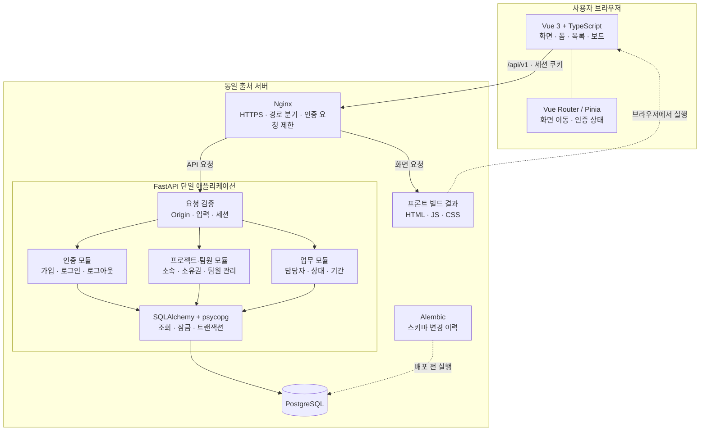
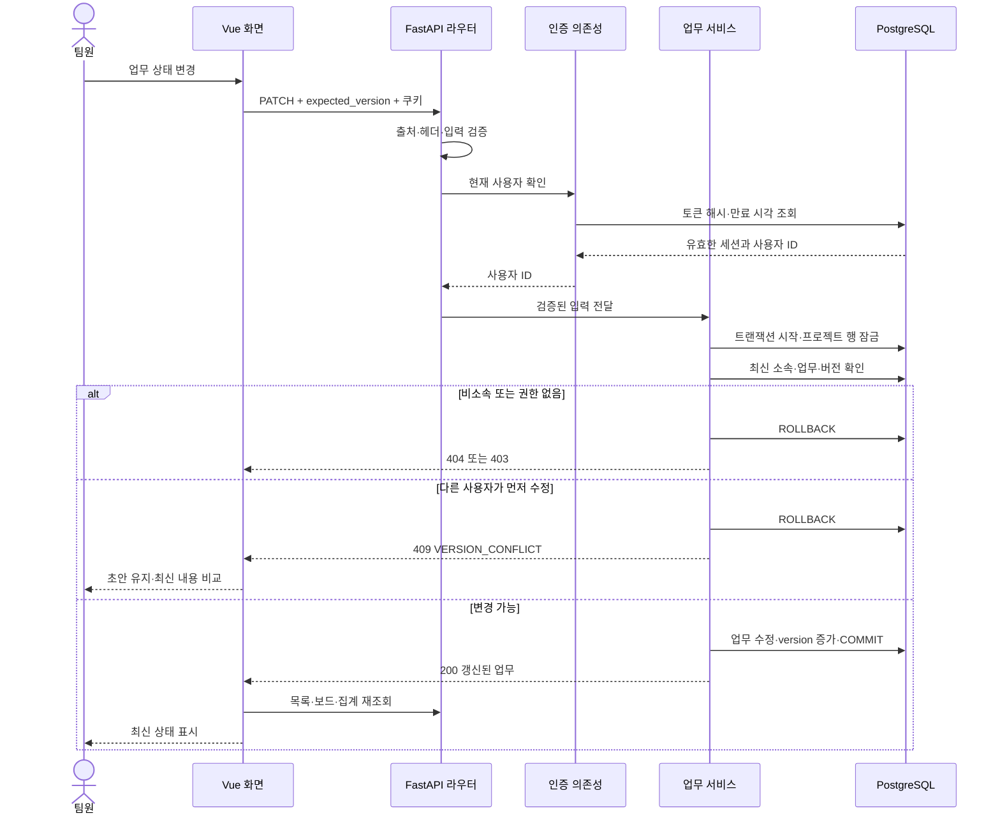
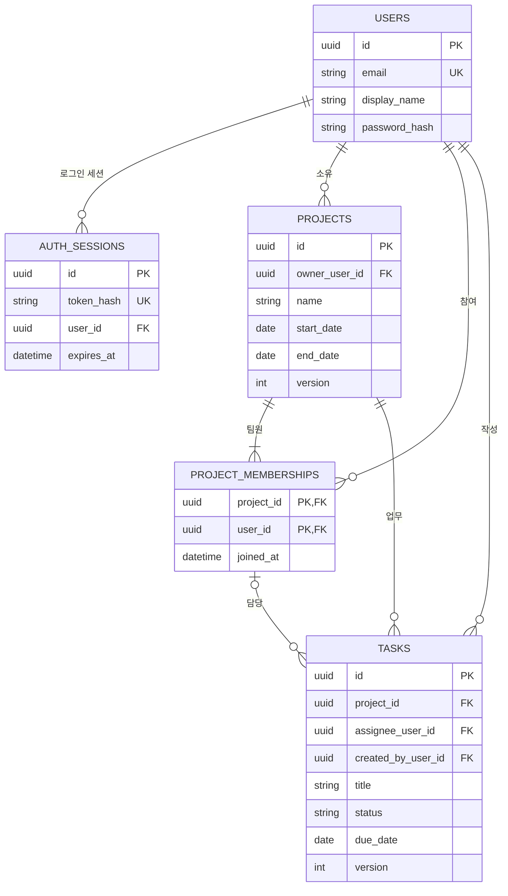
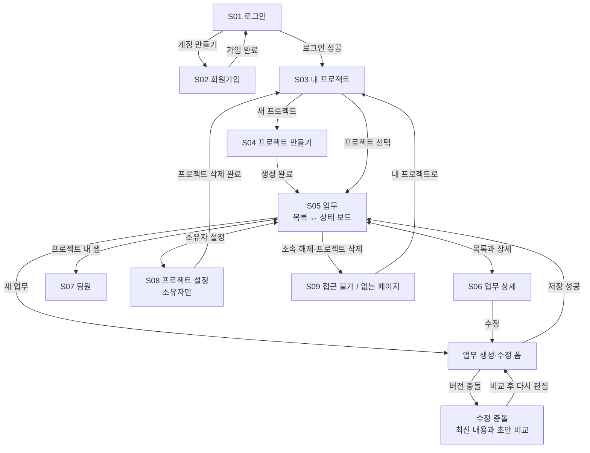

# AM_PM MVP — 시스템 구조도·화면 흐름도

- 작성일: 2026-10-03
- 상태: 상세 설계 0.2에 대한 시각화, 사용자 검토용
- 기준: [상세 설계](2026-10-03-am-pm-mvp-design.md), [API 계약](2026-10-03-am-pm-mvp-api-contract.md), [화면 명세](2026-10-03-am-pm-mvp-screens-verification.md)

그림은 구현할 시스템의 구조를 표현한다. 현재 배포된 서비스 구성을 의미하지 않는다. 프로젝트·팀원·업무 모듈은 하나의 FastAPI 프로세스 안에 있으며 독립 서비스가 아니다.

## 1. 전체 시스템 구조

브라우저는 동일 출처의 `/api/v1`만 호출한다. HttpOnly 쿠키는 브라우저가 전달하며 Vue 코드가 세션 토큰을 읽거나 저장하지 않는다. 개발 환경에서는 Nginx의 API 전달 역할을 Vite proxy가 수행한다.

## 2. 업무 수정 요청의 처리 흐름

인증 조회 Session은 짧게 종료하고 서비스는 별도 Session의 트랜잭션을 사용한다. 인증 실패는 서비스 실행 전에 401로 끝난다. 위 순서도는 유효한 인증을 통과한 업무 변경의 주요 분기다.

## 3. 핵심 데이터 관계

가독성을 위해 감사 시각·설명 등 일부 열을 생략했다. 상세 타입·null·인덱스는 설계 본문을 따른다. 담당자 연결은 `(project_id, assignee_user_id)` 복합 FK다. 소유자는 소속 멤버여야 하며 지연 검사되는 소유자 멤버십 FK로 보장한다.

## 4. 화면 이동 흐름

상세 화면에서 편집을 열었다면 성공 후 상세에 머물고, 목록·보드에서 새 업무를 만들었다면 원래 화면을 갱신한다. 그림의 ‘저장 성공’ 화살표는 업무 영역으로 돌아오는 흐름을 요약한다. 세션이 만료되면 어느 보호 화면에서든 로그인으로 이동한다.

## 5. 화면 시안에서 확인할 항목

- 로그인·회원가입, 프로젝트 목록·생성, 업무 목록·보드·상세, 팀원, 설정, 접근 불가 화면.
- 소유자와 팀원의 메뉴·관리 버튼 차이.
- 업무 생성·수정, 삭제 확인, 팀원 추가·제거, 소유권 이전 대화상자.
- 빈 데이터, 조회 실패, 수정 충돌 화면 상태.
- 데스크톱과 좁은 화면의 정보 배치.

대화 안의 화면 시안은 예시 데이터로 동작하는 검토용 프로토타입이다. 실제 계정 생성·로그인·DB 저장은 수행하지 않는다. 모바일 미리보기의 보드 열은 시안의 가독성을 위해 세로로 배치했으며, 제품의 모바일 보드 이동 방식은 화면 명세의 가로 스크롤과 비교해 검토할 수 있다.
